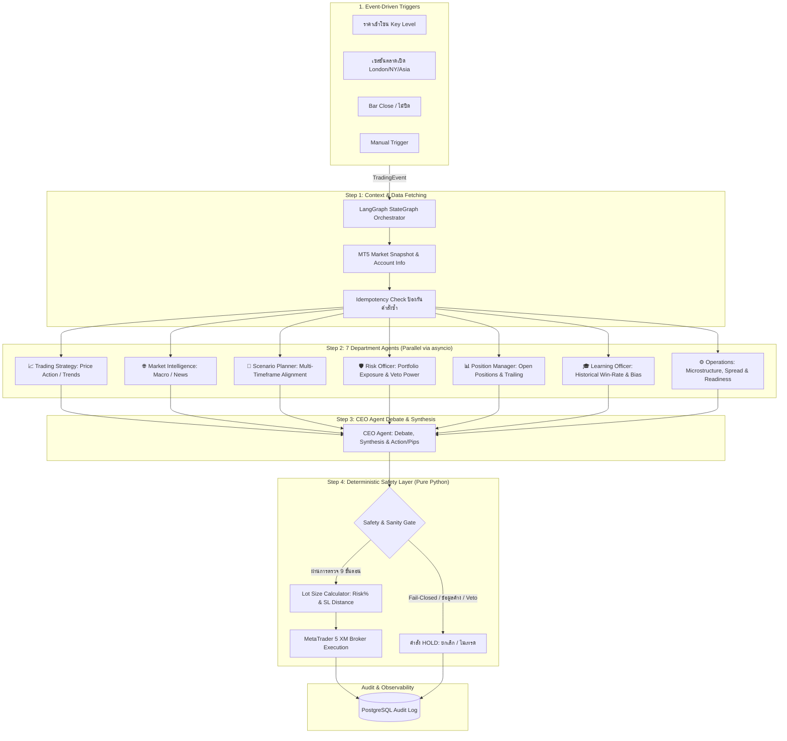

# 🏛️ LLM-Driven Multi-Agent Trading System (Gemma 3 + MT5 / XM)

ระบบเทรดอัตโนมัติที่ขับเคลื่อนด้วย LLM สถาปัตยกรรม **Multi-Agent แบบลำดับขั้น (Hierarchical)** บน **LangGraph** ควบคู่กับ **Deterministic Safety Layer** ฝั่ง Python ที่บังคับใช้กฎความปลอดภัยและควบคุมความเสี่ยงอย่างเข้มงวด 100% โดยไม่ให้ LLM แตะต้องตัวเลขเงินหรือขนาด Lot Size เด็ดขาด

---

## 📐 สถาปัตยกรรมระบบ (Architecture Overview)



---

## 🔒 3 กฎเหล็กความปลอดภัย (Deterministic Safety Layer)

1. **LLM ห้ามคำนวณเงินหรือขนาดไม้เด็ดขาด**:
   - LLM (Gemma 3) ทำหน้าที่วิเคราะห์และระบุเพียงทิศทาง (`BUY`, `SELL`, `HOLD`) และระยะ `sl_pips` / `tp_pips`
   - ขนาด Lot Size ถูกคำนวณผ่าน [`safety/lot_calculator.py`](safety/lot_calculator.py) ด้วยสูตร:
     $$\text{Risk Amount} = \text{Balance} \times \text{Risk\%}$$
     $$\text{Lot Size} = \frac{\text{Risk Amount}}{\text{SL Pips} \times \text{Pip Value per Lot}}$$
   - ปัดเศษตาม Step ของโบรเกอร์ และ Clip ให้อยู่ในช่วง `MIN_LOT` ถึง `MAX_LOT` เสมอ

2. **Fail-Closed Protection**:
   - หากข้อมูลตลาดค้างเกินค่าที่กำหนด (`DATA_STALENESS_SECONDS`) ระบบจะสั่ง **HOLD ทันที**
   - หาก Risk Officer หรือ Operations Agent ให้คำแนะนำ **HOLD** จะถือเป็นสิทธิ์ **VETO** ส่งผลให้การตัดสินใจสุดท้ายเป็น **HOLD ทันที**
   - หาก Broker ขัดข้อง, JSON ล้มเหลว หรือ Context ดึงข้อมูลไม่ได้ ระบบจะ Fallback สู่ **HOLD** โดยไม่เสี่ยงเปิดออเดอร์เด็ดขาด

3. **JSON Repair Loop & Idempotency Key**:
   - ป้องกันปัญหา LLM ตอบ JSON ผิดไวยากรณ์ด้วย Multi-Strategy Repair (ตัด Markdown, จัดการ Trailing Comma, กรอง Outer Brackets) สูงสุด 3 รอบ
   - ระบบ Idempotency Key (SHA-256 จาก Event, Symbol และ Time Bucket) ป้องกันการส่งออเดอร์ซ้ำซ้อนในสภาวะตลาดผันผวน

---

## 📂 โครงสร้างไดเรกทอรีโปรเจกต์

```text
Trader_Code/
├── main.py                          # จุดเริ่มต้นระบบ (CLI, Event loop, Graceful shutdown)
├── config.py                        # โหลดและ Validate การตั้งค่าจาก .env ผ่าน Pydantic Settings
├── requirements.txt                 # รายการ Dependencies ทั้งหมด
├── .env.example                     # แม่แบบ Environment Variables
│
├── agents/                          # LLM Agents (Gemma 3 4B via Ollama)
│   ├── base_agent.py                # Abstract Base Class + Ollama LLM Connection + JSON Repair
│   ├── ceo_agent.py                 # CEO Agent (Synthesize รายงาน 7 แผนก + ตัดสินใจเด็ดขาด)
│   ├── trading_strategy_agent.py    # แผนก 1: Head of Trading & Price Action
│   ├── market_intelligence_agent.py # แผนก 2: Macroeconomics & News Sentiment
│   ├── scenario_planner_agent.py    # แผนก 3: Scenario Planner (Monthly -> Weekly -> Daily)
│   ├── risk_officer_agent.py        # แผนก 4: Risk Officer (มีสิทธิ์ Veto เมื่อความเสี่ยงสูง)
│   ├── position_manager_agent.py    # แผนก 5: จัดการ Portfolio และ Open Positions
│   ├── learning_officer_agent.py    # แผนก 6: สถิติการเทรดย้อนหลังและ Statistical Bias
│   └── operations_agent.py          # แผนก 7: ตรวจ Spread, สภาพคล่อง, และระบบส่งคำสั่ง
│
├── core/                            # กลไก Workflow & State
│   ├── state.py                     # โครงสร้าง TradingState TypedDict กลาง
│   ├── orchestrator.py              # LangGraph StateGraph (4-Step Workflow)
│   ├── parallel_runner.py           # ตัวจัดการรัน 7 แผนกแบบคู่ขนาน (Parallel Runner)
│   └── event_bus.py                 # Async Pub/Sub Event Bus + MT5 Price & Session Monitor
│
├── safety/                          # Deterministic Safety Layer (Pure Python)
│   ├── safety_layer.py              # ประตูความปลอดภัย 9 ด่าน (Fail-Closed)
│   ├── lot_calculator.py            # คำนวณ Lot Size ตาม Risk% และระยะ SL จริง
│   ├── json_repair.py               # กลไกซ่อมแซม JSON Output ของ LLM
│   └── idempotency.py               # ทะเบียนตรวจสอบและป้องกัน Event ซ้ำ
│
├── data/                            # การเชื่อมต่อข้อมูลตลาด
│   ├── market_data.py               # ดึงข้อมูลจาก MetaTrader 5 (XM) และสร้าง MarketSnapshot
│   └── staleness_checker.py         # ตรวจสอบความสดใหม่ของข้อมูลตลาด
│
├── logging_/                        # Audit Logging & Traceability
│   ├── audit_logger.py              # บันทึก Workflow Run และผลวิเคราะห์ลง PostgreSQL
│   └── decision_trace.py            # จัดรูปแบบ Trace สำหรับพิมพ์หรือบันทึกลง Log
│
├── scripts/                         # สคริปต์ช่วยติดตั้งและตรวจสอบระบบ
│   ├── setup_db.py                  # ตรวจสอบและสร้างตาราง PostgreSQL
│   └── test_mt5_connection.py       # ทดสอบการเชื่อมต่อ MT5 กับโบรเกอร์ XM
│
└── tests/                           # ชุดทดสอบอัตโนมัติ (Automated Test Suite)
    ├── test_safety_layer.py         # Unit Tests สำหรับ Lot Calculator, JSON Repair, และ Safety
    └── test_orchestrator.py         # Integration Tests สำหรับ LangGraph Workflow
```

---

## 🚀 คู่มือการติดตั้งและการใช้งาน

### 1. ติดตั้ง Dependencies

```bash
pip install -r requirements.txt
```

### 2. ดาวน์โหลดโมเดล Gemma 3

ตรวจสอบว่าได้ติดตั้งและเปิดใช้งาน [Ollama](https://ollama.ai) แล้ว จากนั้นรันคำสั่ง:

```bash
ollama pull gemma3:4b
```

### 3. ตั้งค่าสภาพแวดล้อม (`.env`)

คัดลอกไฟล์ `.env.example` ไปเป็น `.env`:

```bash
copy .env.example .env
```

แก้ไขข้อมูลสำคัญใน `.env`:
- **MT5_LOGIN**, **MT5_PASSWORD**, **MT5_SERVER**: ข้อมูลบัญชี XM ของคุณ
- **MT5_PATH**: พาธของโปรแกรม `terminal64.exe` ของ XM MT5
- **DATABASE_URL**: URL สำหรับเชื่อมต่อ PostgreSQL (หากไม่มี ระบบจะทำงานในโหมด Console Log)

---

## 🧪 การทดสอบและการรันระบบ

### 1. รันทดสอบ Unit & Integration Tests ทั้งหมด

```bash
pytest tests/ -v
```

### 2. ตรวจสอบการเชื่อมต่อ MetaTrader 5 (XM)

```bash
python scripts/test_mt5_connection.py
```

### 3. ตรวจสอบและตั้งค่าฐานข้อมูล PostgreSQL

```bash
python scripts/setup_db.py
```

### 4. รันทดสอบ 1 รอบในโหมดจำลอง (Simulate Mode)

ทดสอบการตัดสินใจของ 7 แผนกและ CEO บนข้อมูลจำลองโดยไม่ต้องเปิดโปรแกรม MT5:

```bash
python main.py --simulate --once XAUUSD
```

### 5. เริ่มต้นระบบเทรดจริงแบบ Event-Driven (Live Production)

ระบบจะเปิดตัว Monitor เฝ้าระวังราคาและเซสชันตลาดเพื่อสั่งการตามสถานการณ์จริง:

```bash
python main.py
```
